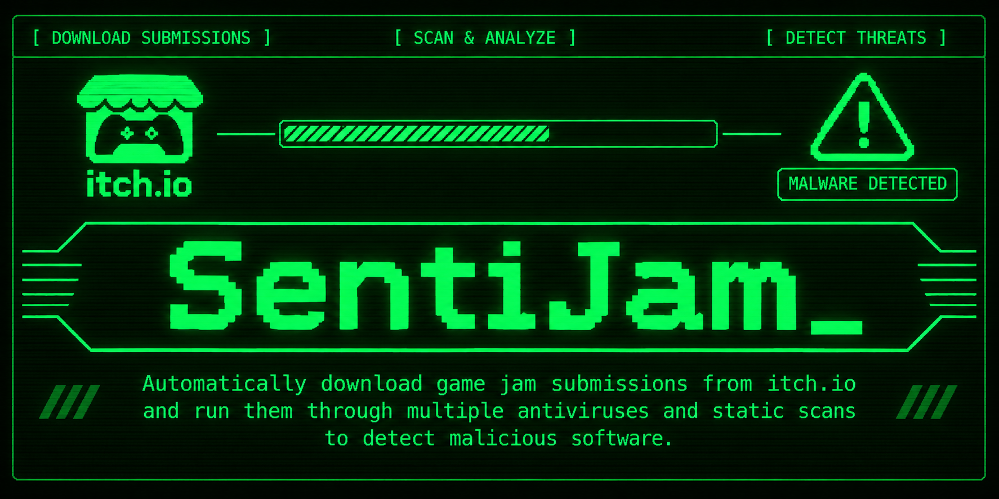
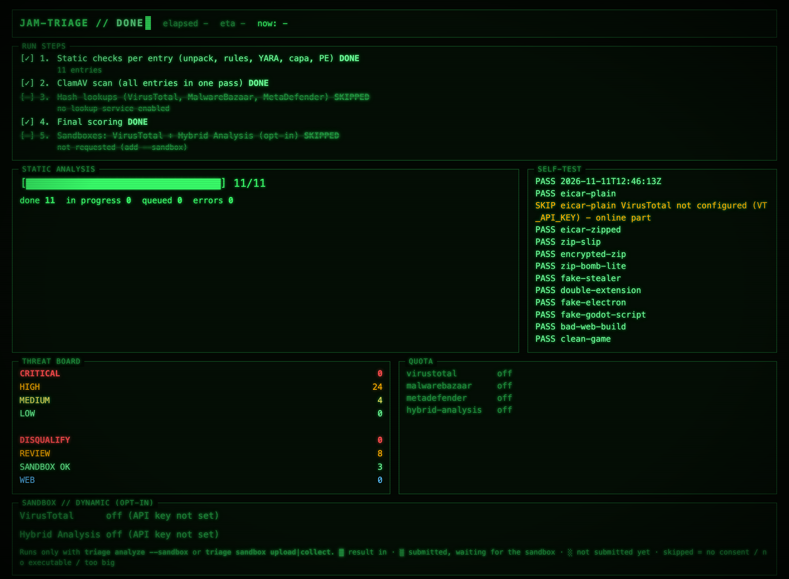
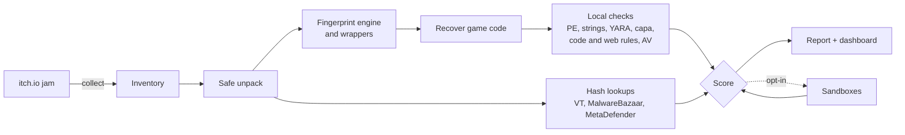
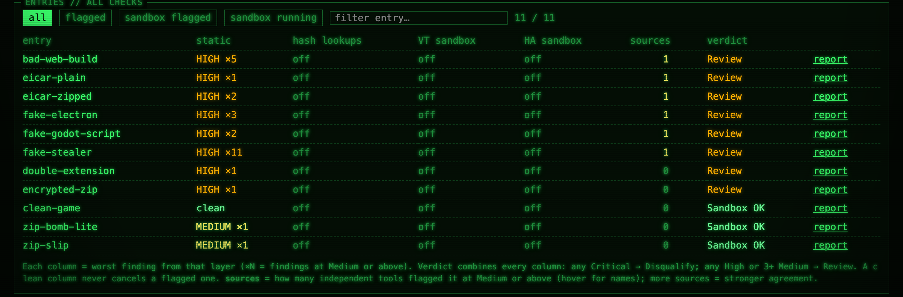

# SentiJam

**Malware triage for game jam submissions.** jam-triage downloads every entry of an itch.io jam, inspects it **without ever running it**, and tells you which builds judges can play in a sandbox, which need a human look, and which should be disqualified, with the evidence for each.




It doesn't prove a file is safe. It makes the obvious cases obvious, says plainly what it could *not* inspect, and leaves the final call to you.

**Contents:** [Why](#why) · [Features](#features) · [Quick start](#quick-start) · [How it works](#how-it-works) · [Installation](#installation) · [Commands](#commands) · [Sandboxes](#sandboxes-opt-in) · [Dashboard and reports](#dashboard-and-reports) · [Configuration](#configuration) · [Safety and privacy](#safety-and-privacy)

## Why

Game jams ask judges to download and run dozens of executables from strangers. itch.io scans uploads, but scanning isn't perfect, and malware campaigns keep trading on itch.io's reputation: fake "test my game" pages, and fake "game update" comments that delivered Lumma Stealer.

jam-triage is the middle layer of three:
1. **Jam rules** keep risky formats out: web builds preferred, no installers, no password-protected archives.
2. **jam-triage** checks every build before judging starts.
3. **Judges** run downloads only inside a disposable sandbox.

## Features

- **Never executes a submission.** Archives, installers and wrappers are unpacked safely, and game code is recovered and read: Godot scripts, Unity C#, Electron `app.asar`, PyInstaller, Node SEA.
- **Many independent signals:**
  - ClamAV / Microsoft Defender, YARA (YARA Forge core), capa, Detect It Easy;
  - PE and signature analysis, plus string, code and web rules;
  - hash reputation from VirusTotal, MalwareBazaar and MetaDefender.
- **Honest coverage:** anything it couldn't unpack or scan is flagged High, never silently passed.
- **False-positive control:** vendor-signed runtimes, file reputation, and filters for known harmless matches.
- **Opt-in cloud sandboxes** (VirusTotal, Hybrid Analysis) for entries whose authors consented.
- **Quota-safe:** every API request goes through a shared, persisted rate limiter with daily budgets.
- **Live dashboard**, plus Excel and HTML reports.

## Quick start

```bash
triage tools                                   # what's installed, which keys are set
triage selftest                                # prove every check fires (~10 s)
triage collect https://itch.io/jam/your-jam    # download all entries
triage analyze --dashboard                     # analyse; watch http://127.0.0.1:8787
triage report                                  # out/report.xlsx, out/report.html, out/manifest.csv
triage analyze --sandbox                       # optional: cloud sandboxes (public, slow)
triage recheck --collect https://itch.io/jam/your-jam   # before judging ends: nothing swapped?
```

`analyze` is resumable: interrupt it and run it again. Unchanged entries reuse their results, and lookups left over when a daily budget runs out finish on the next run.

## How it works



**Guiding rule: "Sandbox OK" must mean everything was actually looked at.** Content that couldn't be extracted or scanned is a **High** finding: an encrypted member, a RAR without a decoder, an unpacking limit, an Inno Setup installer, a custom packer's payload, a download hosted outside itch.io.

### Verdicts

| Verdict | When | Next step |
| --- | --- | --- |
| **Disqualify** | Any Critical: MalwareBazaar knows the hash, several VirusTotal engines agree, or a sandbox saw data theft | Check the evidence, report the page to itch.io |
| **Review** | Any High, or 3+ Medium | Look manually, or send it to a sandbox |
| **Web** | Has an HTML5 build and nothing above | Judges play the web build |
| **Sandbox OK** | Only Low or Info | Judges play it in Windows Sandbox or a VM |

Typical findings:
- **High:** antivirus or YARA hits, stealer strings (browser password files, Discord webhooks), `CryptUnprotectData`, credential/anti-VM/persistence capabilities, installers, double extensions, anything not scanned.
- **Medium:** packed or engine-less executables, nested archives, single non-ML VirusTotal hits.
- **"Not found"** in a hash lookup means **unknown**, not clean, and *Sandbox OK* never means "safe on a real PC".

**How tools are combined.** There's no probability score. Every tool adds findings to one list, and the worst one decides; a clean result never cancels a flagged one. Each entry also shows **independent sources**: how many separate tools flagged it at Medium or above. That's a hint about how strongly the tools agree; it doesn't change the verdict.

**Keeping false positives down**
- **Runtime files** like `UnityPlayer.dll` get lenient treatment only with a valid signature from a known vendor; a file merely carrying the name is scanned like anything else.
- **File reputation:** our own heuristics drop to Low on files VirusTotal has known for over a year, scanned by 60+ engines with zero detections. Antivirus detections and "not scanned" findings are never lowered.
- **capa string rules** ignore known harmless words (a weekday table's "Friday" matching the debugger `frida`, a game's "Dash" move matching the cryptocurrency) and bytes inside packed data.

**Speed.** Several entries are analysed at once (`[analysis] workers`, default 3). capa, the slowest and most memory-hungry tool, is capped at 2 runs at a time and skipped on stock Godot engine executables, whose game scripts are recovered and checked instead. Its output is cached by file hash, so re-runs after a rule change take minutes, not hours.

## Installation

Python 3.12+. Every external tool is optional: a missing one shows its check as "not run". `triage tools` lists what was found.

```bash
git clone https://github.com/Ojin13/SentiJam.git && cd SentiJam
python3 -m venv .venv && source .venv/bin/activate
pip install -r requirements.txt && pip install -e .
cp .env.example .env                 # add your API keys
triage fetch-rules                   # YARA Forge core rules
```

**macOS tools:**
- **Antivirus:** `brew install clamav`. Then copy `freshclam.conf.sample` to `freshclam.conf`, comment out its `Example` line, and run `freshclam`.
- **7-Zip:** use the [official 7-Zip](https://www.7-zip.org/download.html) build (`7zz`). Homebrew's `sevenzip` has no RAR decoder.
- **Analysers:** [Detect It Easy](https://github.com/horsicq/DIE-engine/releases), [capa](https://github.com/mandiant/capa/releases) and [GDRE Tools](https://github.com/GDRETools/gdsdecomp/releases). Download them from their releases pages.
- **Extractors:** `dotnet tool install -g ilspycmd` (Unity C#) and `pip install node-sea-scallop` (Node SEA).
- **Tools outside your `PATH`:** point to them in `config.local.toml`, a personal, git-ignored file merged over `config.toml`:

```toml
[tools.paths]
diec = "~/jam-triage-tools/die_mac_portable/die.app/Contents/MacOS/diec"
gdre = "~/jam-triage-tools/Godot RE Tools.app/Contents/MacOS/Godot RE Tools"
capa = "~/jam-triage-tools/capa"
7z   = "~/jam-triage-tools/7zip/7zz"
```

**Windows:** `winget install 7zip.7zip Microsoft.DotNet.SDK.8`, plus the Windows builds of the tools above. Defender is built in. Run jam-triage **inside Windows Sandbox or a VM**.

**API keys** (all free) go in `.env`, which is git-ignored:

| Variable | Service | Used for |
| --- | --- | --- |
| `ITCH_API_KEY` | [itch.io](https://itch.io/user/settings/api-keys) | `collect` |
| `VT_API_KEY` | [VirusTotal](https://www.virustotal.com/) | hash reputation, VirusTotal sandbox (recommended) |
| `MB_AUTH_KEY` | [MalwareBazaar](https://bazaar.abuse.ch/api/) | known-malware check (recommended) |
| `MD_API_KEY` | [MetaDefender](https://metadefender.opswat.com/) | second opinion |
| `HA_API_KEY` | [Hybrid Analysis](https://www.hybrid-analysis.com/) | sandbox. New keys are "restricted": upgrade under Profile > API key before submitting |

## Commands

| Command | What it does |
| --- | --- |
| `triage tools` | Installed tools, API keys and YARA rules |
| `triage selftest [--offline]` | Full pipeline on harmless fixtures (EICAR, zip-slip, fake stealer, ...) |
| `triage collect <jam-url>` | Downloads every entry with itch-dl into `data/builds/` |
| `triage analyze [--dashboard] [--entry <slug>] [--only <check>] [--force] [--workers N] [--sandbox]` | Analyses all (or some) entries; `--only` re-runs single checks, `--workers` sets how many run at once, `--sandbox` adds the sandboxes |
| `triage report` | Excel, HTML and the hash manifest; keeps your *final verdict*, *consent* and *notes* columns |
| `triage recheck [--collect <jam-url>]` | Re-queries hashes and compares builds with the manifest |
| `triage sandbox plan\|upload\|collect\|status [--provider virustotal\|hybrid]` | Batch sandbox runs within the rate limits |
| `triage detonate <entry>` / `triage upload <entry> <file>` | One entry by hand (public, needs consent) |
| `triage dashboard` | Serves the dashboard for an existing `data/` folder |

Paid or restricted entries can't be downloaded: put them in `data/builds/<entry>/` by hand.

## Sandboxes (opt-in)

Two free cloud sandboxes can run a game's main executable in a Windows VM and report what it did. **They never run by default**, because uploads become **public** and take far longer than the static checks.

1. Record consent: `[sandbox] consent_all = true` in `config.toml`, or mark consent per entry in `report.xlsx`.
2. Opt in per run with `triage analyze --sandbox`, or by hand with `triage sandbox plan`, then `upload`, then `collect` about 30 minutes later.

| | VirusTotal | Hybrid Analysis |
| --- | --- | --- |
| Free limits | 4 req/min, 500/day (shared with lookups) | 100 submissions/day |
| Uploads | main exe up to 650 MB; skipped if already known | main exe up to 100 MB |
| 150 games | 1–2 days of budget | 2 days |

- Sandbox results only ever **add** findings; a quiet run never improves a verdict.
- Daily limits stop a run cleanly, and the next run continues.
- Every upload is logged to `data/uploads.jsonl`.

## Dashboard and reports

`triage analyze --dashboard` (or `triage dashboard`) serves a live, terminal-style page on `http://127.0.0.1:8787`:
- the run's steps, with an ETA;
- API quotas;
- sandbox progress;
- one row per entry, showing the worst finding from each layer (static, lookups, each sandbox), the number of independent sources, and the verdict.



`triage report` writes these files to `out/`:
- **`report.xlsx`**: one row per entry, plus every finding. Your own *final verdict*, *consent* and *notes* columns survive rebuilds.
- **`report.html`**: the reasons for each verdict.
- **`manifest.csv`**: hashes for `recheck`.

## Configuration

Everything lives in `config.toml`. Every key has a built-in default and a comment. Put machine-specific settings (tool paths, consent) in `config.local.toml`, which overrides `config.toml` and is never committed. The ones you're most likely to touch:

| Setting | Default | Purpose |
| --- | --- | --- |
| `[virustotal] daily_budget` | 480 | stays under the free 500/day; values above the free tier are clamped unless `premium = true` |
| `[*] max_lookups_per_entry` | 12–40 | so one app with hundreds of DLLs can't eat the budget |
| `[unpack] max_total_bytes / max_files / max_depth` | 4 GB / 20k / 2 | archive safety limits |
| `[analysis] workers` | 3 | entries analysed at the same time |
| `[analysis] max_parallel_capa` | 2 | capa runs at the same time; use 1 with less than 32 GB of RAM |
| `[tools] capa_timeout` | 900 s | per file |
| `[tools] max_tool_memory_mb` | 8192 | any tool using more is stopped, its child processes too |
| `[sandbox] consent_all` | false | true only if every entrant agreed to public uploads |

Detection rules are editable YAML in `rules/`:
- `custom.yaml`: string rules and trusted signers;
- `code.yaml`: per-language code rules;
- `web.yaml`: HTML5 build rules;
- `yara/`: the YARA rules from `triage fetch-rules`.

Run `triage selftest` after editing them.

## Safety and privacy

- **Nothing from a submission is ever executed.** Extracted files never get execute permission. Every external tool runs with a timeout and a memory ceiling, and its child processes are stopped with it.
- **Run it on Windows only inside Windows Sandbox or a VM.** On macOS, never open Windows builds through Wine or shared VM folders.
- **Hash lookups send only a fingerprint**, never the file.
- **Uploads are public** and happen only through the opt-in sandbox commands, only with consent, and are logged. Suggested jam rule:

> By submitting, you agree that organisers may submit your build to online malware scanners and sandboxes (such as VirusTotal and Hybrid Analysis), where it may become publicly visible.

## Acknowledgements

jam-triage glues together excellent free tools. Please respect their licences and terms:
[itch-dl](https://github.com/DragoonAethis/itch-dl) ·
[VirusTotal](https://www.virustotal.com/) ·
[MalwareBazaar](https://bazaar.abuse.ch/) ·
[MetaDefender Cloud](https://metadefender.opswat.com/) ·
[Hybrid Analysis](https://www.hybrid-analysis.com/) ·
[ClamAV](https://www.clamav.net/) ·
[7-Zip](https://www.7-zip.org/) ·
[Detect It Easy](https://github.com/horsicq/Detect-It-Easy) ·
[capa](https://github.com/mandiant/capa) ·
[YARA](https://github.com/VirusTotal/yara) and [YARA Forge](https://yarahq.github.io/) ·
[pefile](https://github.com/erocarrera/pefile) ·
[signify](https://github.com/ralphje/signify) ·
[GDRE Tools](https://github.com/GDRETools/gdsdecomp) ·
[ILSpy](https://github.com/icsharpcode/ILSpy) ·
[pyinstxtractor-ng](https://github.com/pyinstxtractor/pyinstxtractor-ng) ·
[scallop](https://github.com/dariushoule/node-sea-scallop) ·
[WebTUI](https://github.com/webtui/webtui)

The free VirusTotal and MetaDefender tiers are for **non-commercial use**.

## License

MIT. See [LICENSE](LICENSE).

## Disclaimer

jam-triage is a triage aid, not an antivirus. It can miss malware and it can flag harmless games. Always keep judges' downloads inside a sandbox, and make the final call yourself.
